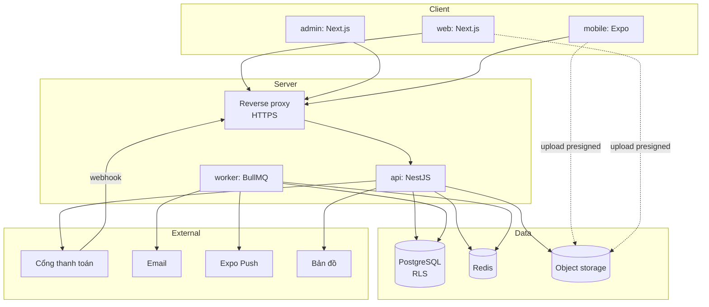
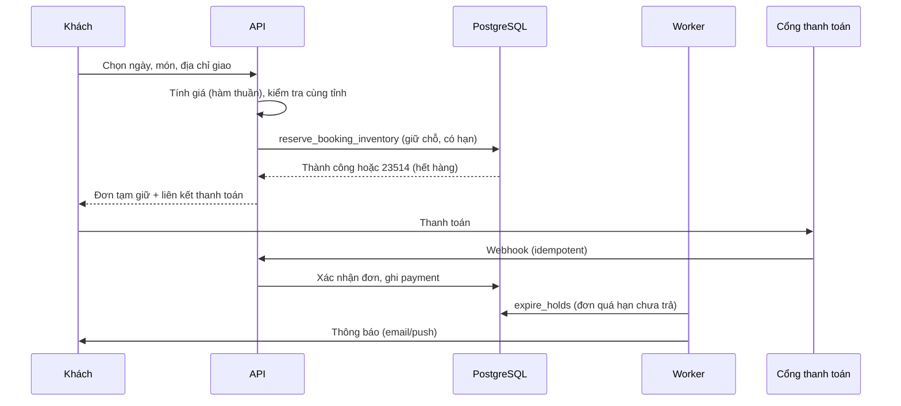

# Kiến trúc hệ thống

**Trạng thái:** Nháp · **Cập nhật lần cuối:** 2026-11-15

## 1. Kiểu kiến trúc: modular monolith

Một ứng dụng API chia module theo nghiệp vụ, một cơ sở dữ liệu, một tiến trình worker. Lý do: một người phát triển, một miền nghiệp vụ; tách dịch vụ sớm chỉ thêm chi phí vận hành. Ranh giới module rõ để tách sau nếu cần (xem ADR-0003).

## 2. Sơ đồ thành phần

## 3. Đa tenant (multi-tenancy)

- Mỗi cửa hàng là một `tenant`. Mọi bảng nghiệp vụ có `tenant_id`.
- **Hai lớp bảo vệ độc lập:**
  1. Ứng dụng: guard kiểm tra vai trò và quyền sở hữu.
  2. CSDL: Row Level Security, chính sách dựa trên `app.tenant_id` và `app.is_super_admin`.
- Mỗi request: mở giao dịch → `SET LOCAL app.tenant_id = ...` → chạy truy vấn → đóng giao dịch. Biến chỉ sống trong giao dịch, không rò sang request khác trong cùng kết nối.
- Role kết nối của ứng dụng **không phải superuser** (superuser bỏ qua RLS).
- Khóa ngoại ghép `(tenant_id, id)` để không thể tham chiếu chéo tenant.

## 4. Luồng đặt thuê (tóm tắt)

Chi tiết nghiệp vụ: `../04-product/booking-flow.md`. Thuật toán giá và tồn kho: `../03-api/booking-pricing.md`.

## 5. Đồng thời và tính đúng đắn

- **Chặn đặt trùng ở tầng DB:** `inventory_calendar` (biến thể × đêm) với `CHECK (reserved <= capacity)`. Hai giao dịch đồng thời cùng giữ chỗ: một thành công, một nhận lỗi `23514`, API ánh xạ sang "hết hàng".
- **Sổ cái chỉ thêm:** `inventory_movements`, `booking_status_history`, `audit_logs` có trigger cấm sửa/xóa.
- **Idempotency:** API ghi (tạo đơn, thanh toán, hoàn tiền) nhận `Idempotency-Key`; webhook lưu `payment_webhook_events` theo mã sự kiện duy nhất.
- **Múi giờ:** DB đặt `Asia/Ho_Chi_Minh`; "đêm" tính theo ngày địa phương.

## 6. Xác thực và phiên

- Access token JWT ngắn hạn (vài phút), refresh token xoay vòng, lưu băm ở DB để thu hồi.
- Web: refresh token trong cookie `HttpOnly`, `Secure`, `SameSite`. Mobile: `expo-secure-store`.
- Mật khẩu băm argon2. Giới hạn thử đăng nhập, khóa tạm khi vượt ngưỡng.

## 7. Tệp và ảnh

- Client xin **presigned URL** từ API, tải thẳng lên object storage (không đi qua API).
- Bảng `files` lưu siêu dữ liệu và chủ sở hữu; kiểm tra loại và dung lượng ở API trước khi cấp URL.
- Ảnh giấy tờ xác minh nằm ở vùng riêng tư, chỉ truy cập qua URL ký có thời hạn ngắn.

## 8. Quan sát hệ thống (observability)

- Log JSON có `request_id`, `tenant_id`, `user_id`; không ghi dữ liệu nhạy cảm.
- Số liệu: độ trễ, lỗi, độ sâu hàng đợi, số đơn giữ chỗ hết hạn.
- Cảnh báo: tỷ lệ lỗi tăng, webhook thất bại, hàng đợi tồn đọng, đối soát lệch.

## 9. Giới hạn đã biết (từ thiết kế dữ liệu)

- Giá mùa chồng lấn và tổng bàn giao được kiểm tra ở tầng ứng dụng, không bằng ràng buộc DB.
- Ứng dụng phải tạo biến thể mặc định cho loại món không có size/màu.
- Lịch tồn kho dùng `current_date`; cần đặt múi giờ DB đúng.
