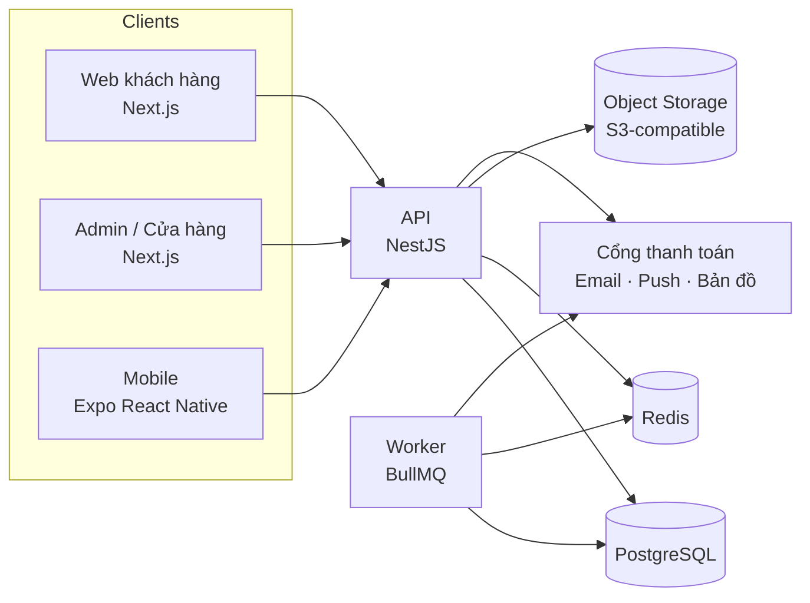

# Công nghệ sử dụng (Tech Stack)

**Trạng thái:** Đã duyệt hướng tổng thể (2026-11-17); các điểm 🟡 vẫn chờ spike P0 · **Cập nhật lần cuối:** 2026-11-17

Nguyên tắc chọn công nghệ cho dự án làm một mình, chuẩn doanh nghiệp:

1. **Một ngôn ngữ cho toàn hệ thống (TypeScript).** Giảm chi phí chuyển ngữ cảnh, chia sẻ kiểu dữ liệu giữa web, mobile, API.
2. **Công nghệ phổ biến, tài liệu nhiều, tuyển dụng dễ.** Không chọn thứ quá mới chỉ vì thú vị.
3. **Ưu tiên tính đúng đắn dữ liệu.** Đặt thuê, tồn kho, tiền cọc là nơi sai một lần là mất tiền.
4. **Mọi thứ chạy được trên máy cá nhân bằng Docker Compose.** Không phụ thuộc dịch vụ trả phí để phát triển.
5. **Kiến trúc đơn giản trước, tách dịch vụ sau.** Dự án một người không cần microservices.

> Ký hiệu: ✅ đã chốt · 🟡 đề xuất, cần kiểm chứng bằng bản dựng thử (spike) trước khi khóa.
> Phiên bản cụ thể ghi ở `package.json` khi khởi tạo repo; ở đây chỉ nêu "bản ổn định mới nhất (LTS)".

## 1. Tổng quan

## 2. Ngôn ngữ và nền tảng chung

| Hạng mục | Lựa chọn | Trạng thái | Lý do |
|---|---|---|---|
| Ngôn ngữ | TypeScript (strict mode) | ✅ | Kiểu dữ liệu xuyên suốt, bắt lỗi sớm |
| Runtime | Node.js LTS | ✅ | Ổn định, hệ sinh thái lớn |
| Quản lý gói | pnpm | ✅ | Nhanh, tiết kiệm đĩa, hỗ trợ workspace tốt |
| Monorepo | pnpm workspaces, chạy bằng `pnpm -r` (không Turborepo, ADR 0010) | ✅ | Chạy theo thứ tự phụ thuộc, chia sẻ package; cấu hình giữ trong `workspace/` |
| Chất lượng code | ESLint, Prettier, `tsc --noEmit` | ✅ | Chuẩn hóa, chạy trong CI |
| Validation | Zod (dùng chung client và server) | ✅ | Một schema, dùng cho form và API |

## 3. Backend (API)

| Hạng mục | Lựa chọn | Trạng thái | Lý do / ghi chú |
|---|---|---|---|
| Framework | NestJS | ✅ | Cấu trúc module rõ, DI, guard cho RBAC; hợp "modular monolith" |
| Kiểu API | REST + OpenAPI (Swagger) | ✅ | Sinh tài liệu và client kiểu an toàn |
| Truy cập DB | Kysely (query builder có kiểu) + kysely-codegen | ✅ Kysely (spike RLS đạt, ADR 0012); kysely-codegen chờ duyệt | Giữ SQL là trung tâm, hợp với RLS và hàm `reserve_inventory`. Phương án khác: Drizzle, Prisma (khó hơn khi dùng RLS và `SET LOCAL`) |
| Migration | SQL thuần, quản lý bằng dbmate (ADR 0004) | ✅ | Schema hiện có là SQL thuần (49 bảng, trigger, RLS) nên giữ SQL làm nguồn sự thật |
| Xác thực | JWT access token ngắn hạn + refresh token xoay vòng, băm mật khẩu argon2 | ✅ | Chuẩn cho web và mobile |
| Phân quyền | RBAC qua bảng `memberships` + guard phía server + RLS ở DB | ✅ | Hai lớp bảo vệ độc lập |
| Hàng đợi / tác vụ nền | BullMQ trên Redis | ✅ | Hết hạn giữ chỗ (`expire_holds`), gửi thông báo, webhook thanh toán |
| Cache, rate limit | Redis | ✅ | Giới hạn tần suất, khóa phân tán nhẹ |
| Tệp | S3-compatible (Cloudflare R2 hoặc S3 khi chạy thật; **giả lập khi dev chờ chốt**: image MinIO cộng đồng đã ngừng phát hành), upload qua presigned URL | 🟡 | Ảnh sản phẩm, giấy tờ xác minh, ảnh bàn giao |
| Email | Resend hoặc SMTP | 🟡 | Giao dịch (xác nhận đơn, quên mật khẩu) |
| Push | Expo Push Notifications (FCM/APNs bên dưới) | ✅ | Đi cùng Expo |
| Thanh toán | PayOS, VNPay hoặc MoMo (chọn một cho MVP) | 🟡 | Cần xác nhận điều kiện đăng ký tài khoản merchant cho cá nhân |
| Bản đồ, khoảng cách | API trả phí theo lượt có gói miễn phí (ứng viên Goong); không tự host OSRM (2026-11-17) | 🟡 | Tính khoảng cách giao hàng theo `delivery_fee_rules` |
| Log, lỗi | Pino (JSON log) + Sentry | ✅ | Có `request_id` và `tenant_id` trong mỗi dòng log |

## 4. Cơ sở dữ liệu

| Hạng mục | Lựa chọn | Trạng thái |
|---|---|---|
| CSDL | PostgreSQL 15+ (đã kiểm thử trên 16) | ✅ |
| Cô lập tenant | Row Level Security, `SET LOCAL app.tenant_id` mỗi giao dịch | ✅ |
| Khóa ngoại | Composite FK `(tenant_id, id)` | ✅ |
| Tồn kho | `inventory_calendar` (biến thể × đêm) + `inventory_movements` (sổ cái chỉ thêm) | ✅ |
| Tìm kiếm | Postgres full-text search + `unaccent` + `pg_trgm` (hỗ trợ tiếng Việt không dấu) | 🟡 |
| Múi giờ | DB đặt `Asia/Ho_Chi_Minh` | ✅ |

Chi tiết: `../02-database/schema-overview.md`.

## 5. Frontend web (khách hàng và quản trị)

| Hạng mục | Lựa chọn | Trạng thái | Lý do |
|---|---|---|---|
| Framework | Next.js (App Router) | ✅ | SSR/SEO cho trang sản phẩm, một codebase cho web khách và admin |
| UI | Tailwind CSS + shadcn/ui (Radix) | ✅ | Nhanh, truy cập tốt (a11y), dễ tùy biến |
| Trạng thái máy chủ | TanStack Query | ✅ | Cache, đồng bộ dữ liệu từ API |
| Form | React Hook Form + Zod | ✅ | Dùng chung schema với backend |
| Bảng dữ liệu | TanStack Table | ✅ | Màn hình quản trị nhiều bảng |
| Biểu đồ | Recharts | 🟡 | Báo cáo doanh thu, tỷ lệ lấp đầy |
| Animation | GSAP + `@gsap/react` khi CSS không đủ; hiệu ứng đơn giản dùng CSS/Tailwind (ADR 0011) | ✅ | Timeline, theo cuộn, FLIP; chỉ chạy phía client; không dùng cho mobile |
| i18n | next-intl, mặc định tiếng Việt | 🟡 | Sẵn sàng thêm tiếng Anh |
| Ứng dụng | Hai app tách: `web` (khách) và `admin` (cửa hàng + super admin) | ✅ | Khác bố cục, khác quyền, deploy độc lập |

## 6. Mobile

| Hạng mục | Lựa chọn | Trạng thái | Lý do |
|---|---|---|---|
| Framework | Expo (React Native) + Expo Router | ✅ | Một codebase iOS/Android, dùng chung TypeScript và Zod |
| Trạng thái, dữ liệu | TanStack Query | ✅ | Giống web |
| Lưu trữ bảo mật | expo-secure-store (token) | ✅ | Không lưu token ở nơi không mã hóa |
| Quét mã QR | expo-camera | 🟡 | Nhân viên kho quét khi bàn giao/nhận lại |
| Ảnh bàn giao | expo-image-picker + upload presigned | 🟡 | Chứng cứ tình trạng đồ |
| Phát hành | EAS Build | 🟡 | Bản thử nội bộ trước, lên store sau |

Mobile phục vụ hai nhóm: **khách hàng** (tìm, đặt, theo dõi đơn) và **nhân viên** (giao nhận, kho, CSKH). Hiển thị theo vai trò.

## 7. Hạ tầng và DevOps

| Hạng mục | Lựa chọn | Trạng thái |
|---|---|---|
| Dev cục bộ | Docker Compose (Postgres, Redis, Mailpit; giả lập S3 chờ chốt thay MinIO) | ✅ |
| CI | GitHub Actions: lint, typecheck, test, build | ✅ |
| Container | Docker, ảnh nhiều tầng (multi-stage) | ✅ |
| Chạy thật (giai đoạn đầu) | Một VPS + Docker Compose + Caddy/Traefik (HTTPS tự động) | 🟡 |
| Chạy thật (khi cần mở rộng) | Chuyển sang dịch vụ quản lý (managed Postgres, container platform) | ⬜ |
| Cấu hình, bí mật | Biến môi trường, kiểm tra bằng Zod lúc khởi động; bí mật không commit | ✅ |
| Giám sát | Sentry (lỗi), OpenTelemetry + Grafana/Prometheus (số liệu), health check | 🟡 |
| Sao lưu | `pg_dump` định kỳ + thử khôi phục | ✅ |

## 8. Kiểm thử

| Loại | Công cụ | Phạm vi |
|---|---|---|
| Đơn vị | Vitest | Hàm tính giá, tính số đêm, quy tắc phí |
| Tích hợp API + DB | Vitest/Jest + Testcontainers (Postgres thật) | RLS, tồn kho, đồng thời |
| E2E web | Playwright | Luồng đặt thuê, thanh toán |
| E2E mobile | Maestro | Luồng chính |
| Tải | k6 | Đặt trùng cùng một món cùng lúc |

Chi tiết: `../07-quality/testing-strategy.md`.

## 9. Điểm cần kiểm chứng (spike) trước khi khóa 🟡

1. **Kysely + RLS:** mỗi request mở giao dịch, chạy `SET LOCAL app.tenant_id`, kiểm tra không rò dữ liệu giữa tenant.
2. **Cổng thanh toán:** đăng ký merchant bằng tài khoản cá nhân có được không, webhook, hoàn tiền, giữ cọc.
3. **Tính khoảng cách giao hàng:** kiểm tra Goong (hoặc API tương tự trả phí theo lượt) về giới hạn gọi và chi phí; không tự host OSRM.
4. **Tìm kiếm tiếng Việt:** `unaccent` + `pg_trgm` đủ tốt chưa, hay cần công cụ tìm kiếm riêng.
5. **Expo:** quét QR và upload ảnh chạy mượt trên máy thật.

Mỗi spike ghi kết quả thành một ADR.

## 10. Những thứ cố ý không chọn ở giai đoạn này

| Bỏ qua | Lý do |
|---|---|
| Microservices | Một người, một domain; modular monolith đủ, tách sau nếu cần |
| GraphQL | Tăng độ phức tạp cache và phân quyền, REST + OpenAPI đủ |
| Kubernetes | Quá nặng cho quy mô hiện tại |
| Công cụ tìm kiếm riêng (Elasticsearch) | Postgres FTS đủ cho MVP |
| Sự kiện/Kafka | BullMQ đủ cho tác vụ nền |
