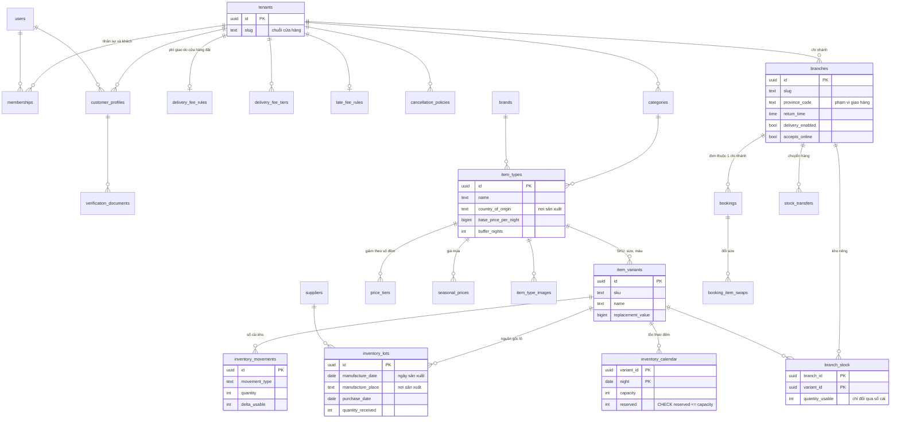
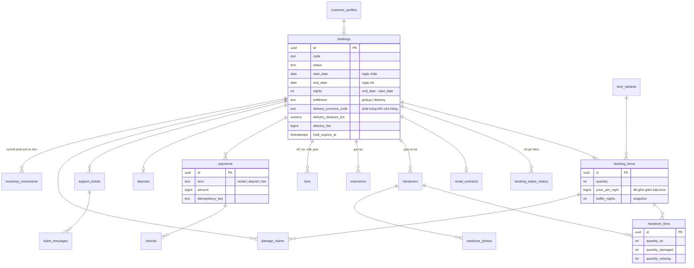

# ERD: Rentwell

**Trạng thái:** Đã duyệt (P1) · **Cập nhật lần cuối:** 2026-11-15

SQL đi kèm: `schema-001-init.sql` (PostgreSQL 15+, đã chạy thử trên 16: 49 bảng, 2026-11-17). Sơ đồ Mermaid chỉ hiển thị cột chính.

## Quyết định đã chốt
1. **Mọi món đều theo số lượng.** Không theo dõi từng chiếc. Giày hay bông tai là 1 món. Tồn kho tính theo **biến thể (SKU)**; món không có size/màu vẫn có 1 biến thể "Mặc định".
2. **Tính theo đêm.** Nhận 10, trả 12 = 2 đêm. Khoảng thuê là `[ngày nhận, ngày trả)`.
3. **Giao hàng:** mỗi cửa hàng tự đặt cách tính phí (cố định, theo km, hoặc theo bậc khoảng cách) và bán kính tối đa. Chỉ giao trong cùng tỉnh/thành của cửa hàng.

## Sơ đồ 1: cửa hàng, tài khoản, danh mục, tồn kho

## Sơ đồ 2: đơn thuê, tiền, chăm sóc khách hàng

## Luồng chính ở mức SQL
1. Tạo `bookings` (status = hold, có `hold_expires_at`) và `booking_items`.
2. Gọi `reserve_booking_inventory(tenant, booking)`: giữ chỗ các đêm `[start, end + đêm đệm)`. Hết hàng thì DB báo lỗi **23514** (ràng buộc `inventory_not_oversold`); app đổi thành "hết hàng ngày này".
3. Thanh toán cọc thành công thì `confirmed`. Không kịp thì job gọi `expire_holds()` mỗi phút để nhả tồn.
4. Hủy đơn: `release_booking_inventory(tenant, booking)`.
5. Giao đồ: `handovers(kind='handover')`. Trả đồ: `handovers(kind='return')` với `handover_lines` ghi số lượng tốt, hư, mất.
6. Nhân viên kho ghi hư/mất vào `inventory_movements`; `branch_stock.quantity_usable` và lịch tồn của chi nhánh tự cập nhật. Giảm xuống thấp hơn số đã đặt ở các đêm tương lai thì DB chặn, buộc xử lý các đơn bị ảnh hưởng trước.
7. Giao tận nơi: app tính khoảng cách và phí theo `delivery_fee_rules`; DB chặn nếu khác tỉnh hoặc cửa hàng chưa bật giao hàng (lỗi 23514).

## Đã kiểm thử trên PostgreSQL 16
- Nhập kho cộng đúng; thuê 10→12 ra 2 đêm.
- Đặt vượt số lượng bị từ chối; đặt vừa đủ được chấp nhận.
- Hai phiên đặt cùng lúc 2/3 đôi cho cùng đêm: phiên sau chờ, rồi bị từ chối, không đặt lố.
- `expire_holds()` nhả đúng tồn.
- Giảm số lượng dưới số đã đặt bị chặn.
- Giao khác tỉnh bị chặn; cùng tỉnh được.
- Sổ cái kho không sửa/xóa được.
- Cửa hàng B không đọc/ghi được dữ liệu cửa hàng A (RLS); tham chiếu chéo bị khóa ngoại chặn.

## Giới hạn cần biết
- Role kết nối của app phải là role thường (không superuser, không owner), mỗi request phải `SET LOCAL app.tenant_id`.
- Khoảng giá mùa chồng nhau cho cùng món chưa bị DB chặn: app kiểm tra (hoặc thêm `btree_gist` sau).
- Tổng `quantity_ok + damaged + missing` khi trả phải bằng số đã thuê: app kiểm tra.
- Mỗi loại món phải có ít nhất một biến thể: app tạo "Mặc định" khi tạo loại món.
- Lịch tồn dùng `current_date`: đặt timezone DB là `Asia/Ho_Chi_Minh`.
- `price_per_night` lưu đã gồm giảm bậc/mùa; công thức tính giá nằm ở tầng app và cần test riêng.
