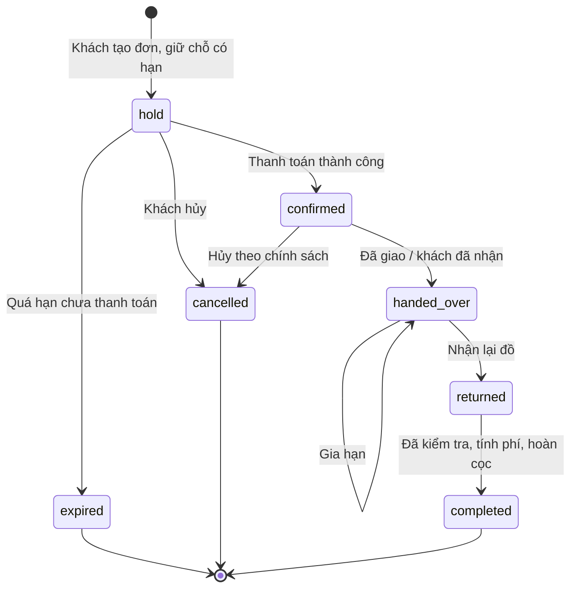

# Vòng đời đơn thuê

**Trạng thái:** Nháp · **Cập nhật lần cuối:** 2026-11-15

## 1. Sơ đồ trạng thái

> Tên trạng thái khớp ràng buộc `CHECK` của `bookings.status` trong `schema-001-init.sql`: `hold`, `confirmed`, `handed_over`, `returned`, `completed`, `cancelled`, `expired`. Việc soạn đồ ở kho là công việc, không phải trạng thái đơn.

## 2. Mô tả từng bước

| Bước | Ai | Hệ thống làm gì |
|---|---|---|
| Chọn món, ngày | Khách | Kiểm tra còn trống, báo giá (`/quotes`), thấy tổng chi phí chi tiết |
| Chọn nhận tại cửa hàng hoặc giao tận nơi | Khách | Nếu giao: kiểm tra cùng tỉnh, tính khoảng cách và phí |
| Tạo đơn | Khách | Giữ chỗ trong giao dịch; đơn ở `hold`, hạn thanh toán **15 phút** (ADR 0009) |
| Thanh toán | Khách | Một lần trả gồm thuê + giao + cọc, qua merchant của chuỗi; webhook xác nhận → `confirmed` **tự động**, cửa hàng không duyệt tay (ADR 0009) |
| Soạn đồ | Nhân viên kho | Kiểm tra tình trạng, đóng gói (danh sách việc, đơn vẫn ở `confirmed`) |
| Giao / nhận tại cửa hàng | Nhân viên giao nhận / kho | Biên bản bàn giao, chụp ảnh tình trạng, khách ký nhận → `handed_over` |
| Trong thời gian thuê | Khách | Có thể gia hạn nếu còn trống; đổi size tại chi nhánh đã thuê; nhắc trả đồ trước hạn |
| Nhận lại | Nhân viên | Biên bản trả: số lượng tốt/hỏng/mất, ảnh → `returned` |
| Kiểm tra và chốt | Kho + quản lý | Ghi hư hỏng vào sổ cái kho, tính phí trễ/bồi thường, hoàn cọc → `completed` |
| Tồn kho sau trả | Hệ thống | Hết đêm đệm thì món sẵn sàng cho thuê lại (giặt, kiểm tra) |

## 3. Quy tắc nghiệp vụ

1. Tồn kho chỉ giữ cho đơn `hold` và `confirmed` trở đi; `expired` và `cancelled` phải nhả tồn.
2. Đơn không thể sang `handed_over` nếu chưa thanh toán đủ (thuê + cọc).
3. Đơn không thể `completed` khi còn dòng bàn giao chưa khớp số lượng.
4. Gia hạn chỉ được nếu các đêm kế tiếp còn trống sau khi tính đêm đệm; có thể phát sinh phí.
5. Mọi chuyển trạng thái ghi `booking_status_history` (ai, khi nào, lý do); không sửa lịch sử.
6. Đồ hỏng/mất tạo bút toán trong `inventory_movements`; `branch_stock.quantity_usable` của chi nhánh đó giảm tương ứng.
7. Khi đồ hỏng/mất làm tồn thấp hơn số đã đặt ở tương lai, hệ thống chặn; người quản lý phải xử lý các đơn bị ảnh hưởng trước (đổi món, hủy, thông báo).

## 4. Thông báo theo sự kiện (P7)

| Sự kiện | Gửi cho |
|---|---|
| Đơn tạo, sắp hết hạn giữ chỗ | Khách |
| Thanh toán thành công | Khách, cửa hàng |
| Đồ đã soạn xong, đã giao | Khách |
| Sắp đến hạn trả, trả trễ | Khách, cửa hàng |
| Đã nhận lại, hoàn cọc | Khách |
| Có việc giao nhận mới | Nhân viên giao nhận |

## 5. Trường hợp ngoại lệ cần xử lý

- **Khách không đến nhận** (hoặc vắng mặt khi giao), đã chốt 2026-11-15: giữ đồ đến hết ngày nhận (`start_date`, theo giờ đóng cửa chi nhánh). Hết ngày mà chưa bàn giao: job chuyển đơn `confirmed` → `cancelled` (lý do "khách không đến nhận"), nhả tồn các đêm còn lại, **hoàn cọc, giữ tiền thuê**.
- **Trả trễ**: tính phí trễ theo `late_fee_rules` (cấp chuỗi), hạn là `return_time` của chi nhánh trong ngày `end_date`.
- Đồ hỏng nặng hoặc mất: bồi thường theo `replacement_value`.
- **Thanh toán đến sau khi giữ chỗ đã hết hạn**, đã chốt 2026-11-15: tồn đã nhả. Khi webhook báo thanh toán thành công cho đơn `expired`, hệ thống **thử giữ chỗ lại** đúng ngày, đúng chi nhánh (`reserve_booking_inventory`). Thành công: đơn `expired` → `confirmed`. Hết hàng: **tự hoàn tiền** và báo khách. Ghi `booking_status_history` cả hai trường hợp.
- Webhook đến trùng hoặc đảo thứ tự: xử lý idempotent, kiểm tra trạng thái hiện tại.

## Quy tắc bổ sung (đã chốt 2026-11-17, ADR 0009)

- **Đơn tại quầy:** khách vãng lai chỉ cần tên và số điện thoại (hồ sơ khách theo chuỗi, chưa gắn tài khoản); không qua `hold`, tạo thẳng `confirmed` khi đã ghi nhận thu tiền tại quầy. Lược đồ: `../02-database/proposal-004-walkin-holidays-config.md` (chờ duyệt).
- **Gia hạn:** tính lại theo tổng số đêm mới, thu phần chênh (`booking-pricing.md` mục 2).
- **Đóng chi nhánh:** bị chặn khi còn đơn mở (`hold`, `confirmed`, `handed_over`), còn tồn kho hoặc còn phiếu chuyển hàng chưa xong tại chi nhánh đó; hệ thống liệt kê việc còn lại.
- **Hết ngày nhận:** tính theo giờ đóng cửa của chi nhánh trong ngày đó (`opening_hours`: mỗi thứ một khung giờ, có ngày nghỉ).
- **Hoàn tiền (kể cả tự hoàn khi hết hàng):** về đúng kênh đã trả, lệnh hoàn gửi trong 24 giờ.

## Quy tắc chi nhánh (đã chốt, ADR 0006)

- Đơn online: khách nhập địa chỉ, chọn chi nhánh trong danh sách sắp từ gần đến xa (chọn sẵn chi nhánh gần nhất còn đủ hàng); đơn tại quầy: chi nhánh của nhân viên tạo đơn. Đơn đã tạo không đổi chi nhánh.
- Giao, nhận, trả đồ và đổi size chỉ ở chi nhánh của đơn; ở chi nhánh khác bị từ chối.

## Đổi size (đã chốt 2026-11-15)

- Khách tự đến chi nhánh đã thuê. Quần áo, thời trang (`free_size_exchange`) không thu phí; món khác thu hoặc hoàn chênh lệch giá tại quầy.
- **Trước khi nhận đồ** (`confirmed`): đổi cho cả kỳ thuê.
- **Đang thuê** (`handed_over`): khách mang món cũ đến; nhân viên kiểm tra tình trạng (hư hỏng ghi theo luồng thường); món cũ bị chiếm thêm số đêm đệm rồi nhả các đêm còn lại; món mới giữ từ hôm nay tới hết kỳ. Còn ít nhất một đêm thuê mới đổi được.
- Hàm `swap_booking_inventory`; lịch sử bất biến `booking_item_swaps`.
