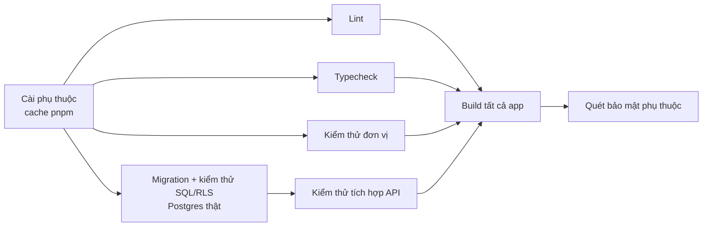

# CI/CD và phát hành

**Trạng thái:** Nháp · **Cập nhật lần cuối:** 2026-11-15

## 1. Pipeline CI (mỗi PR và mỗi lần đẩy lên nhánh chính)

Hiện tại (`.github/workflows/ci.yml`, 2026-11-21): job `quality` chạy `pnpm test` gồm cả kiểm thử tích hợp API trên Postgres riêng do Testcontainers dựng; job `database` chạy migration, seed, kiểm thử SQL/RLS trên Postgres của Compose và kiểm kiểu sinh bởi kysely-codegen khớp migration (`db:codegen:verify`).

Điều kiện gộp PR: tất cả bước xanh, ít nhất một lần tự review, không còn bí mật bị lộ (quét bí mật).

E2E (Playwright, Maestro) chạy theo lịch hàng đêm và trước phát hành, không chặn mỗi PR để giữ CI nhanh.

## 2. Phát hành

| Bước | Nội dung |
|---|---|
| Gắn thẻ phiên bản | `vMAJOR.MINOR.PATCH` (SemVer) trên nhánh chính |
| Build ảnh | Docker nhiều tầng cho `api`, `worker`, `web`, `admin` |
| Staging | Tự động triển khai khi gộp vào nhánh chính |
| Production | Kích hoạt tay sau khi staging đạt (kiểm thử E2E và duyệt) |
| Migration | Chạy **trước** khi bật mã mới; migration phải **tương thích ngược** một phiên bản (mở rộng rồi mới thu hẹp) |
| Mobile | EAS Build; bản thử nội bộ, sau đó gửi cửa hàng ứng dụng |

## 3. Rollback

- Ảnh Docker giữ các phiên bản trước; quay lại phiên bản cũ bằng một lệnh.
- Migration phá vỡ **không** được áp trong cùng lần phát hành với mã phụ thuộc; dùng mô hình mở rộng/thu hẹp để rollback mã mà không rollback dữ liệu.
- Mỗi lần phát hành ghi: phiên bản, thời gian, người thực hiện, kết quả.

## 4. Sao lưu và khôi phục

- `pg_dump` hằng ngày (và WAL nếu dùng), lưu ra ngoài máy chủ.
- **Thử khôi phục thật** ít nhất mỗi quý và trước ra mắt; ghi lại thời gian khôi phục.
- Sao lưu object storage hoặc bật phiên bản đối tượng.

## 5. Danh sách kiểm tra trước ra mắt (P8)

- [ ] CI xanh, E2E luồng chính đạt
- [ ] Kiểm thử tải chống đặt trùng đạt
- [ ] Kiểm thử cô lập tenant đạt trong CI
- [ ] Role ứng dụng không phải superuser/owner (đã kiểm ở production)
- [ ] Sao lưu chạy và đã thử khôi phục
- [ ] Giám sát và cảnh báo hoạt động (Sentry, số liệu, health check)
- [ ] Giới hạn tần suất, header bảo mật, CORS đúng
- [ ] Cổng thanh toán ở chế độ thật, webhook đã kiểm
- [ ] Chính sách quyền riêng tư và điều khoản đã rà soát
- [ ] Runbook xử lý sự cố, quy trình rollback đã diễn tập
