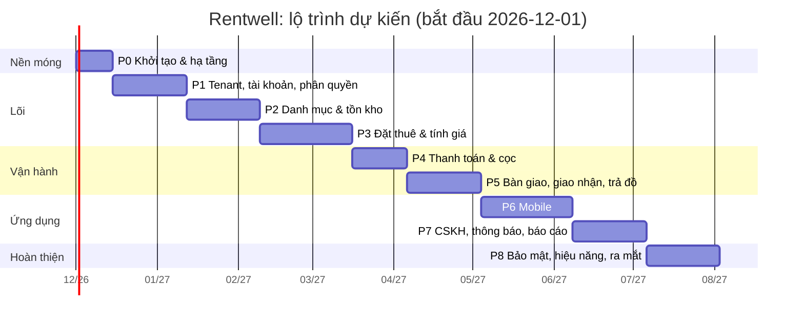

# Lộ trình phát triển (Roadmap)

**Trạng thái:** Đã duyệt (2026-11-17) · **Cập nhật lần cuối:** 2026-11-17

## 1. Giả định lập kế hoạch

- Một người làm, kiêm việc học, dự kiến **10 đến 15 giờ mỗi tuần**.
- Thời lượng dưới đây tính theo **tuần làm việc thực tế ở nhịp đó**, đã gồm kiểm thử và viết tài liệu. Đây là ước lượng, không phải cam kết; mỗi giai đoạn kết thúc bằng một lần điều chỉnh.
- Mỗi giai đoạn tạo ra phần mềm **chạy được và demo được**. Không để "xây hết rồi mới ghép".
- Thứ tự theo rủi ro: phần khó nhất về dữ liệu (tồn kho, đặt thuê, cô lập tenant) làm sớm, giao diện đẹp để sau.

## 2. Tổng quan

| Giai đoạn | Tên | Thời lượng ước tính | Kết quả demo được |
|---|---|---|---|
| P0 | Khởi tạo và hạ tầng | 2 tuần | Repo chạy, CI xanh, `docker compose up` ra hệ thống rỗng |
| P1 | Tenant, tài khoản, phân quyền | 4 tuần | Đăng ký cửa hàng, mời nhân viên, đăng nhập theo vai trò |
| P2 | Danh mục và tồn kho | 4 tuần | Cửa hàng đăng món có biến thể, nhập kho, xem tồn |
| P3 | Đặt thuê và tính giá | 5 tuần | Khách chọn ngày, thấy giá, giữ chỗ, tạo đơn |
| P4 | Thanh toán và cọc | 3 tuần | Trả tiền thật (sandbox), giữ và hoàn cọc |
| P5 | Bàn giao, giao nhận, trả đồ | 4 tuần | Giao đồ, chụp ảnh, nhận lại, tính phí trễ và hư hỏng |
| P6 | Mobile | 5 tuần | App khách và app nhân viên chạy trên máy thật |
| P7 | CSKH, thông báo, báo cáo | 4 tuần | Phiếu hỗ trợ, push, email, báo cáo doanh thu |
| P8 | Bảo mật, hiệu năng, ra mắt | 4 tuần | Bản chạy thật, giám sát, sao lưu, tài liệu vận hành |

Tổng ước tính: **khoảng 35 tuần (8 đến 9 tháng)** ở nhịp 10 đến 15 giờ mỗi tuần. **MVP dùng được (P0 đến P5, web)** đạt sau khoảng **21 tuần**.

## 3. Chi tiết từng giai đoạn

> **Cách đánh dấu:** việc nào làm xong thì đổi `[ ]` thành `[x]` kèm ngày, ví dụ `- [x] (2026-12-03) Docker Compose ...`. Trước khi bắt tay vào việc, đọc lại mục này để không làm lại việc đã xong. Tổng hợp theo giai đoạn: `../00-overview/progress.md`.

Mỗi giai đoạn gồm: **Mục tiêu**, **Công việc**, **Tiêu chí hoàn thành (DoD)**, **Rủi ro**.

### P0. Khởi tạo và hạ tầng (2 tuần)

**Mục tiêu:** Có nền móng kỹ thuật để mọi giai đoạn sau chỉ lo nghiệp vụ.

**Công việc**
- [x] (2026-11-15) **Duyệt `proposal-003-branches.md` và sửa `001_init.sql` (thêm chi nhánh, tồn kho theo chi nhánh) TRƯỚC khi áp migration đầu tiên.**
- [x] (2026-11-17) **Duyệt `proposal-004-walkin-holidays-config.md` và sửa `001_init.sql` (khách vãng lai, bảng ngày lễ và phụ thu, cờ xác minh, đóng chi nhánh) TRƯỚC khi áp migration đầu tiên.**
- [x] (2026-11-17) Chạy thử `001_init.sql` mới và `db/tests/001_walkin_holidays_close_branch.sql` trên PostgreSQL 16.16: 19/19 ca đạt.
- [ ] Spike cổng thanh toán: so sánh vài cổng phổ biến ở Việt Nam, trình chủ dự án chọn. **Tiêu chí ưu tiên số 1: chuỗi nhỏ (hộ kinh doanh, cá nhân) tự đăng ký merchant dễ**; kèm sandbox, API hoàn tiền, webhook có chữ ký, khóa và webhook theo từng chuỗi (ADR 0009); sau đó mới xét phí.
- [ ] Spike bản đồ: địa chỉ → tọa độ, khoảng cách đường đi, chi phí, giới hạn gọi. **Hướng đã chọn: API trả phí theo lượt có gói miễn phí** (ứng viên chính Goong), không tự host OSRM.
- [ ] Kiểm tra tên miền cho Rentwell (web + tên miền con admin): Claude liệt kê vài tên miền còn trống, chủ dự án chọn; nếu vướng thì đổi tên sớm. Mua trước P8.
- [ ] MCP loại A (Postgres chỉ đọc trên DB dev, GitHub, Figma): sau khi Docker Compose có Postgres, mô tả từng cái để duyệt lần cuối rồi thêm `.mcp.json`.
- [x] (2026-11-17) Tạo monorepo pnpm, cấu trúc theo `monorepo-structure.md`. ~~Turborepo~~: không chạy được khi cấu hình ở `workspace/`, bỏ và dùng `pnpm -r` (ADR 0010).
- [x] (2026-11-17) Docker Compose: Postgres, Redis, Mailpit; hai role DB (migrator, app). ~~MinIO~~: image cộng đồng đã ngừng phát hành.
- [ ] Chọn giả lập lưu trữ tệp kiểu S3 thay MinIO (cần trước P2), chủ dự án duyệt.
- [x] (2026-11-17) Áp `001_init.sql` bằng dbmate (role migrator); seed 2 chuỗi × 2 chi nhánh (`db/seeds/001_dev_seed.sql`); `pnpm db:test` đạt.
- [x] (2026-11-17) Khung NestJS: cấu hình kiểm tra bằng Zod, log JSON có `request_id` (không ghi header/query), health check có kiểm CSDL, Swagger `/docs`.
- [ ] Khung Next.js (`web`, `admin`) và Expo (`mobile`) rỗng nhưng build được (không giao diện, không CSS, theo cổng thiết kế).
- [ ] CI GitHub Actions: đã viết `.github/workflows/ci.yml` và chạy từng bước trên máy; **chưa chạy trên GitHub** (chờ đẩy nhánh).
- [x] (2026-11-17) Quy ước commit: lefthook (pre-commit: Prettier, ESLint, chặn `.env`; commit-msg: commitlint), template PR có sẵn.
- [ ] **Spike** các điểm 🟡 trong `tech-stack.md` mục 9 (RLS với Kysely trước tiên).

**DoD**
- [ ] `pnpm install && docker compose up && pnpm dev` chạy trên máy sạch theo README.
- [ ] CI xanh trên nhánh chính.
- [ ] ADR cho mỗi spike đã chốt.

**Rủi ro:** Mất thời gian chỉnh công cụ. Giảm thiểu: không tối ưu sớm, dùng mẫu chuẩn.

### P1. Tenant, tài khoản, phân quyền (4 tuần)

**Mục tiêu:** Nhiều cửa hàng cùng chạy trên một hệ thống mà không thấy dữ liệu của nhau.

**Công việc**
- [ ] Chuỗi và chi nhánh (`branches`), nhân viên gắn chi nhánh hoặc cả chuỗi, quyền theo chi nhánh.
- [ ] **Cổng thiết kế:** trước khi làm màn hình đăng nhập và các màn hình đầu tiên, hỏi và chờ thiết kế do người dùng duyệt (`../00-overview/progress.md`, mục "Cổng thiết kế").
- [ ] Đăng ký, đăng nhập, quên mật khẩu, xác minh email.
- [ ] JWT access + refresh xoay vòng, thu hồi phiên.
- [ ] Tạo cửa hàng (tenant), thông tin điểm nhận/trả, tỉnh/thành.
- [ ] `memberships` và vai trò: owner, manager, staff (giao nhận), warehouse, support, customer; `super_admin` là cờ riêng.
- [ ] Guard phân quyền phía API + middleware đặt `app.tenant_id` mỗi giao dịch.
- [ ] Mời nhân viên bằng email, đổi vai trò, vô hiệu hóa.
- [ ] `audit_logs` cho thao tác nhạy cảm.
- [ ] Admin web: đăng nhập, khung giao diện, trang quản lý nhân viên.

**DoD**
- [ ] Bộ kiểm thử tự động chứng minh: tài khoản tenant A **không đọc/ghi được** dữ liệu tenant B (kể cả khi cố ý bỏ qua lớp ứng dụng).
- [ ] Ma trận quyền trong `roles-permissions.md` có kiểm thử tương ứng.
- [ ] Role ứng dụng ở DB **không phải superuser**.

**Rủi ro:** Rò dữ liệu giữa tenant. Giảm thiểu: kiểm thử RLS ngay từ đầu, chạy trong CI.

### P2. Danh mục và tồn kho (4 tuần)

**Mục tiêu:** Cửa hàng quản lý được món đồ và biết còn bao nhiêu.

**Công việc**
- [ ] Tồn kho theo chi nhánh: nhập kho, lô, lịch tồn theo chi nhánh; chuyển kho giữa chi nhánh (đã duyệt, xem `proposal-003-branches.md` mục 3).
- [ ] Bảng ngày lễ dùng chung (super admin nhập) và phụ thu ngày lễ theo chuỗi (ADR 0009).
- [ ] CRUD: danh mục, thương hiệu, nhà cung cấp, loại món, biến thể (SKU: size/màu), ảnh.
- [ ] Thuộc tính động (`attribute_definitions`).
- [ ] Lô hàng (`inventory_lots`): ngày sản xuất, nơi sản xuất, nhà cung cấp, ngày mua.
- [ ] Nhập/xuất/điều chỉnh qua `inventory_movements` (sổ cái chỉ thêm).
- [ ] Bảng giá: bậc theo số đêm (`price_tiers`), giá theo mùa (`seasonal_prices`).
- [ ] Chính sách hủy, phí trễ, quy tắc phí giao hàng (`delivery_fee_rules`, `delivery_fee_tiers`).
- [ ] Upload ảnh qua presigned URL.
- [ ] Trang danh sách, tìm kiếm và lọc món (tiếng Việt không dấu) trên web khách.

**DoD**
- [ ] `branch_stock.quantity_usable` luôn khớp tổng `inventory_movements` (kiểm thử bất biến).
- [ ] Mọi biến thể đều có biến thể mặc định khi loại món không có size/màu.
- [ ] Tìm "ao dai" ra "áo dài".

**Rủi ro:** Mô hình biến thể phức tạp hơn dự kiến. Giảm thiểu: đã có schema kiểm thử; làm lát cắt dọc một loại món trước.

### P3. Đặt thuê và tính giá (5 tuần)

**Mục tiêu:** Khách đặt được đơn mà không bao giờ bị đặt trùng.

**Công việc**
- [ ] Chọn chi nhánh khi đặt: khách nhập địa chỉ, danh sách chi nhánh từ gần đến xa kèm khoảng cách, còn hàng, phí giao; chọn sẵn chi nhánh gần nhất còn đủ; giữ chỗ trong kho chi nhánh.
- [ ] Website chung cho mọi cửa hàng: trang tổng hợp theo danh mục, duyệt, lọc, tìm theo tên trên toàn nền tảng (ADR 0005); slug cửa hàng duy nhất toàn nền tảng.
- [ ] SEO nền tảng cho `apps/web`: metadata, canonical, sitemap, robots, JSON-LD (xem `../07-quality/seo.md`).
- [ ] Dịch vụ tính giá: số đêm `[start_date, end_date)`, bậc giá, giá mùa, phí giao hàng theo quy tắc cửa hàng, cọc. Hàm thuần, kiểm thử bằng bảng ca.
- [ ] Kiểm tra giao hàng cùng tỉnh/thành với cửa hàng; từ chối liên tỉnh.
- [ ] Kiểm tra tồn kho và giữ chỗ bằng `reserve_booking_inventory`; hết hạn giữ chỗ bằng tác vụ nền `expire_holds`.
- [ ] Giỏ đặt thuê nhiều món, tạo `bookings` và `booking_items`, lịch sử trạng thái.
- [ ] Hợp đồng thuê (`rental_contracts`).
- [ ] Web khách: trang món, chọn ngày, xem giá chi tiết, thanh toán (chưa trả tiền thật), xem đơn.
- [ ] Admin: danh sách đơn, duyệt/từ chối/hủy, lịch đặt theo món.
- [ ] Gia hạn thuê (`extensions`) và phí phát sinh (`fees`).

**DoD**
- [ ] Kiểm thử tải k6: 200 yêu cầu đồng thời đặt cùng một biến thể còn 5 cái, đúng 5 đơn thành công, không đơn dư (`CHECK reserved <= capacity` không bao giờ vi phạm).
- [ ] Mọi phép tính giá có kiểm thử đơn vị với ca biên (qua ngày lễ, nhận 10 trả 12 = 2 đêm, vượt mùa).
- [ ] Hủy đơn trả lại đúng tồn kho.

**Rủi ro:** Lỗi múi giờ và tính đêm. Giảm thiểu: DB đặt `Asia/Ho_Chi_Minh`, kiểm thử ca biên.

### P4. Thanh toán và cọc (3 tuần)

**Mục tiêu:** Nhận tiền thật, giữ và hoàn cọc đúng.

**Công việc**
- [ ] Tích hợp cổng thanh toán đã chọn qua spike (sandbox trước).
- [ ] `payments`, `deposits`, `refunds`, `payment_webhook_events`.
- [ ] Webhook idempotent (chống xử lý hai lần), kiểm tra chữ ký.
- [ ] Quy trình: thanh toán giữ chỗ → xác nhận → cọc → hoàn cọc sau khi trả đồ.
- [ ] Đối soát cuối ngày (tác vụ nền), cảnh báo lệch.

**DoD**
- [ ] Gửi cùng một webhook 10 lần chỉ tạo một bản ghi tác động.
- [ ] Mọi biến động tiền có dòng sổ cái tương ứng, truy vết được đến đơn.
- [ ] Hoàn cọc đúng số tiền sau khi trừ phí trễ/hư hỏng.

**Rủi ro:** Điều kiện đăng ký merchant, thời gian duyệt. Giảm thiểu: tìm hiểu từ P0; có phương án thanh toán chuyển khoản đối soát thủ công.

### P5. Bàn giao, giao nhận, trả đồ (4 tuần)

**Mục tiêu:** Vòng đời đồ ngoài đời thực được ghi lại đầy đủ.

**Công việc**
- [ ] Trả đồ đúng chi nhánh của đơn (chặn ở API và cơ sở dữ liệu); đơn tại quầy (offline) tạo bởi nhân viên chi nhánh, ghi nhận thanh toán tại quầy.
- [ ] Đổi size tại chi nhánh đã thuê (giải phóng và giữ chỗ trong một giao dịch, lịch sử bất biến, thu hoặc hoàn chênh lệch tại quầy).
- [ ] Chuyển hàng giữa chi nhánh (Kho): yêu cầu → duyệt → xuất → vận chuyển → nhận, đối chiếu chênh lệch; xem `../02-database/proposal-003-branches.md` mục 3.
- [ ] `handovers`, `handover_lines`, `handover_photos`: bàn giao khi giao và khi nhận lại, tình trạng từng món, ảnh chứng cứ.
- [ ] Giao nhận: nhân viên giao nhận nhận việc, cập nhật trạng thái.
- [ ] Quy trình trả đồ: kiểm tra, ghi nhận hư hỏng (`damage_claims`), tính phí trễ theo `late_fee_rules`.
- [ ] Khôi phục tồn kho khi nhận lại; đưa món vào trạng thái "đang xử lý" (giặt, sửa) nếu cần.
- [ ] Màn hình kho: việc cần soạn, việc cần nhận lại.

**DoD**
- [ ] Một đơn đi trọn vòng: tạo → thanh toán → giao → nhận lại → hoàn cọc, có kiểm thử E2E (Playwright).
- [ ] Không thể đóng đơn khi còn món chưa bàn giao.
- [ ] Tổng bàn giao khớp tổng đơn (kiểm tra ở ứng dụng, đã ghi trong giới hạn đã biết).

### P6. Mobile (5 tuần)

**Mục tiêu:** App thật chạy trên iOS/Android cho khách và nhân viên.

**Công việc**
- [ ] Khách: duyệt, tìm, đặt, thanh toán, theo dõi đơn, gia hạn.
- [ ] Nhân viên giao nhận: danh sách việc, quét QR, chụp ảnh bàn giao, cập nhật trạng thái.
- [ ] Nhân viên kho: soạn đồ, nhận lại, kiểm tra.
- [ ] Đăng nhập, lưu token an toàn, làm mới phiên.
- [ ] Đăng ký push token (`device_tokens`).
- [ ] Đánh giá sản phẩm: khách thuê xong được đánh giá (sao, nhận xét, ảnh); mọi khách xem đánh giá của người khác trong app và trên web; cửa hàng trả lời, manager ẩn khi vi phạm (cần duyệt `../02-database/proposal-002-reviews-routing-chat.md`). Thêm khoảng 1 tuần.
- [ ] Bản thử nội bộ qua EAS.

**DoD**
- [ ] Hai luồng chính chạy trên ít nhất một máy Android và một máy iOS thật.
- [ ] E2E Maestro cho luồng đặt thuê của khách.
- [ ] Mất mạng giữa chừng không làm hỏng trạng thái (thử lại an toàn nhờ idempotency).

**Rủi ro:** Phê duyệt cửa hàng ứng dụng, quyền camera. Giảm thiểu: bắt đầu bản thử sớm, phát hành store ở giai đoạn sau.

### P7. CSKH, thông báo, báo cáo (4 tuần)

**Mục tiêu:** Vận hành hằng ngày trơn tru và có số liệu.

**Công việc**
- [ ] `support_tickets`, `ticket_messages`, giao việc cho nhân viên CSKH.
- [ ] Bộ phận hỗ trợ và định tuyến: cấu hình bộ phận, quy tắc loại phiếu → bộ phận, hàng đợi theo bộ phận, chuyển bộ phận có lịch sử, loại phiếu `feedback`.
- [ ] Chat thời gian thực trên nền phiếu hỗ trợ: nút "Hỏi cửa hàng" ở trang món và "Cần hỗ trợ" trong chi tiết đơn; công nghệ truyền tin (SSE hay WebSocket) cần duyệt trước khi thêm. Thêm khoảng 2 tuần.
- [ ] Thông báo (`notifications`): trong ứng dụng, push, email; mẫu thông báo; tùy chọn nhận.
- [ ] Báo cáo cho chủ cửa hàng: doanh thu, tỷ lệ lấp đầy, món hot, đơn trễ.
- [ ] Soạn tài liệu cho rà soát pháp lý: dữ liệu cá nhân thu thập (hồ sơ chung, giấy tờ xác minh, vị trí, địa chỉ giao), mục đích, nơi lưu, thời hạn, ai truy cập, cùng danh sách câu hỏi để chủ dự án hỏi luật sư trước P8.
- [ ] Bảng điều khiển super admin: danh sách cửa hàng, khóa/mở, số liệu hệ thống.
- [ ] Xác minh danh tính khách (`verification_documents`) cho món giá trị cao.

**DoD**
- [ ] Mỗi sự kiện đơn quan trọng sinh đúng thông báo, không gửi trùng.
- [ ] Báo cáo khớp với dữ liệu thanh toán (kiểm tra đối chiếu).

### P8. Bảo mật, hiệu năng, ra mắt (4 tuần)

**Mục tiêu:** Đủ tin cậy để người thật dùng.

**Công việc**
- [ ] Rà soát bảo mật theo `security.md` (OWASP ASVS cấp độ phù hợp), quét phụ thuộc.
- [ ] Giới hạn tần suất, chống brute-force đăng nhập, CORS/CSP/header bảo mật.
- [ ] Hiệu năng: chỉ mục từ `EXPLAIN`, cache, kiểm thử tải lần cuối.
- [ ] Giám sát: Sentry, số liệu, cảnh báo; sao lưu tự động và **thử khôi phục thật**.
- [ ] Triển khai chạy thật, tên miền, HTTPS, quy trình phát hành và rollback.
- [ ] Tài liệu vận hành (runbook), chính sách quyền riêng tư và điều khoản (cần rà soát pháp lý).
- [ ] Thử với một vài cửa hàng thật (beta kín).

**DoD**
- [ ] Khôi phục từ bản sao lưu thành công trong thời gian ghi nhận được.
- [ ] Không còn lỗ hổng mức cao/nghiêm trọng đã biết.
- [ ] Danh sách kiểm tra ra mắt (`ci-cd.md`) hoàn tất.

### Sau MVP: máy chủ MCP của Rentwell (ADR 0007)

- [ ] Duyệt thêm SDK MCP (mô tả trước khi cài).
- [ ] Bảng `api_keys` (băm, scope, chi nhánh, hạn) và quản lý khóa trong trang quản trị.
- [ ] `apps/mcp` với 6 công cụ chỉ đọc: tồn kho, đơn trong ngày, chi tiết đơn, phiếu chuyển hàng, doanh thu, đánh giá mới.
- [ ] Kiểm thử: khóa chỉ thấy đúng chuỗi/chi nhánh, giới hạn tốc độ, không lộ dữ liệu cá nhân thừa.

## 4. Mốc quan trọng (Milestones)

| Mốc | Sau giai đoạn | Ý nghĩa |
|---|---|---|
| M1 Nền móng | P0 | Môi trường dev tái lập được, CI xanh |
| M2 Cô lập tenant | P1 | Chứng minh được an toàn dữ liệu đa cửa hàng |
| M3 Đặt thuê đúng | P3 | Đặt thuê không trùng, giá đúng |
| **M4 MVP web** | **P5** | **Một đơn đi trọn vòng đời trên web** |
| M5 Có app | P6 | Mobile chạy cho khách và nhân viên |
| M6 Ra mắt beta | P8 | Người thật dùng thử |

## 5. Ngoài phạm vi MVP (để dành)

Nhập vào backlog, không làm trước M4:

- Thuê theo giờ; giao hàng liên tỉnh; nhiều điểm nhận trả cho một cửa hàng.
- Thanh toán quốc tế; chương trình khuyến mãi, mã giảm giá, điểm thưởng.
- Cho thuê dài hạn/đăng ký định kỳ; bảo hiểm đồ thuê.
- Tìm kiếm chéo cửa hàng **nâng cao** (gợi ý, xếp hạng, bản đồ). Phần cơ bản (duyệt, lọc, tìm theo tên trên một website chung) thuộc phạm vi, xem ADR 0005.
- Tự động nhận diện hư hỏng bằng AI.

## 6. Cách quản lý tiến độ

- Mỗi giai đoạn chia thành các **lát cắt dọc** nhỏ (dữ liệu → API → giao diện → kiểm thử), mỗi lát một đến ba ngày.
- Bảng việc (GitHub Projects): cột *Backlog → Đang làm → Review → Xong*; tối đa **hai việc đang làm**.
- Cuối mỗi tuần: ghi chú ngắn (đã xong, bị chặn, điều chỉnh).
- Cuối mỗi giai đoạn: kiểm tra DoD, cập nhật tài liệu, ghi ADR nếu có quyết định mới, **cập nhật lại ước lượng các giai đoạn sau**.
- Quy tắc cắt phạm vi: nếu trễ hơn 30% so với ước lượng, cắt tính năng trong giai đoạn đó, không kéo dài thời gian.

## 7. Rủi ro chính của toàn dự án

| Rủi ro | Mức | Cách giảm thiểu |
|---|---|---|
| Làm một mình, thời gian không đều | Cao | Lát cắt nhỏ, mốc rõ, quy tắc cắt phạm vi |
| Rò dữ liệu giữa cửa hàng | Cao | RLS + kiểm thử tự động trong CI từ P1 |
| Đặt trùng, sai tồn kho | Cao | Ràng buộc DB, kiểm thử tải ở P3 |
| Sai tiền (giá, cọc, hoàn tiền) | Cao | Hàm thuần có bảng ca kiểm thử, sổ cái chỉ thêm |
| Cổng thanh toán không đăng ký được | Trung bình | Tìm hiểu sớm, có phương án đối soát thủ công |
| Phạm vi phình to | Trung bình | Danh sách "ngoài phạm vi", duyệt trước khi thêm |
| Pháp lý (dữ liệu cá nhân, giấy tờ khách) | Trung bình | Chỉ thu thập tối thiểu, rà soát trước khi ra mắt |
| Công nghệ mới làm chậm | Thấp | Chọn công nghệ phổ biến, spike sớm |
